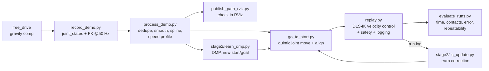

# Task 3 — The Wire-Trace Trial (Addverb HEAL)

Guide a probe on the HEAL arm along a twisted vertical "buzz-wire" **without touching it**, as fast
as possible, three times in a row.

**Pipeline:** teach the path by hand in gravity-compensation mode → record joint states
and tool poses → smooth, interpolate and time-parameterise them → track the result with
**DLS-IK joint-velocity control** → log time, path error and contacts.
**Stage 2 (bonus):** DMP learning-from-demonstration + Iterative Learning Control. The robot
learns the wire over several trials and then runs it in one go.



---

## 1. Repository layout

| Path | What it is |
|---|---|
| `config/heal_wire_trace.yaml` | **Every parameter** in one place: frames, topics, tool offset, speeds, gains, safety limits |
| `wire_trace/` | Library: `trajectory.py` (processing), `controller.py` (DLS-IK tracker and safety), `learning.py` (DMP, ILC, registration), `kdl_kinematics.py` (URDF → KDL FK/Jacobian plus probe offset), `ros_common.py`, `runlog.py`, `plotting.py`, `so3.py` |
| `scripts/` | Things you run in the lab (all take `-h`) |
| `stage2/` | Bonus: `learn_dmp.py`, `ilc_update.py`, `register_stand.py` |
| `tools/fake_robot.py` | Runs any script against a **simulated arm with no ROS installed**, for rehearsing at home |
| `tests/` | `python3 -m pytest -q` (15 tests, including an end-to-end run of the real scripts on the fake robot) |
| `hardware/buzz_contact/` | Optional Arduino sketch that reads the buzz-wire circuit as an objective contact sensor |
| `starter_code/` | The course starter code, unchanged except for one bug fix (`ee_pose_topic` subscription was missing its topic argument) |
| `docs/LAB_PLAYBOOK.md` | Session-by-session plan for the physical work, with troubleshooting |
| `data/demos, processed, runs` | Recorded demos, processed trajectories and run logs (commit the real ones as evidence) |

---

## 2. Setup

**Lab PC:** Ubuntu 22.04, ROS 2 Humble, Python 3.10, the same machine and workspace the starter
code runs on (`~/Debojit_WS/addverb_ws`).

- ROS packages used: `rclpy`, `sensor_msgs`, `std_msgs`, `geometry_msgs`, `nav_msgs`, `PyKDL`
  (`python3-pykdl`), `kdl_parser_py`, `urdf_parser_py`. The starter code already uses all of them,
  so they are present on the lab PC.
- Python packages:
  ```bash
  pip3 install -r requirements.txt
  ```
- Get the code:
  ```bash
  git clone https://github.com/yashpatil-bit/Project_3_ITR_YPK.git && cd Project_3_ITR_YPK
  ```
- Every new terminal on the lab PC:
  ```bash
  source /opt/ros/humble/setup.bash && source ~/Debojit_WS/addverb_ws/install/setup.bash
  ```

**Your own laptop (no robot, no ROS):** `pip3 install -r requirements.txt` is enough for
processing, plotting, the simulator, the tests and `tools/fake_robot.py`.

### Robot bring-up (from the course instructions, `starter_code/LAB_COMMANDS.md`)
```text
T1: ssh cobot@192.168.1.25
    cd /home/cobot/addverb_images/gripper_fix_2026-09-08/
    sudo env HOME=/home/cobot ./cobot run      -> type 1, Enter
    ./heal_server     (position/velocity control)   OR
    ./free_drive      (gravity compensation, move by hand)   OR
    ./base_rigid      (go home)
T2 (only with heal_server running):
    cd ~/Debojit_WS/addverb_ws && source install/setup.bash
    ros2 launch addverb_cobot_control velocity_control.launch.py
```

### First-time configuration (`config/heal_wire_trace.yaml`, lines marked `# MEASURE`)
1. `python3 scripts/check_setup.py` checks that topics, URDF, KDL chain, joint names, limits and
   the current tool pose are all OK.
2. `robot.tool_xyz` / `tool_rpy`: the probe tip relative to the `end-effector` frame. Measure it
   with a ruler. Teach and replay use the same FK, so a small error here does not shift the
   path, but it does affect orientation-error compensation, speed limits and the workspace box.
3. `controller.workspace_min/max`: free-drive the probe around the wire stand and run
   `python3 scripts/capture_points.py --out data/stand_box.npy`. Use the printed bounding box
   plus a few cm.
4. `controller.qdot_max`: keep at or below the HEAL joint velocity limits (ask the TA).

---

## 3. Teaching phase (record waypoints)

1. T1: `./free_drive` (gravity compensation). The buddy holds the E-stop.
2. Check that joint states still arrive: `python3 scripts/check_setup.py --watch` (the pose must
   change when you move the arm by hand).
3. Record:
   ```bash
   python3 scripts/record_demo.py --name demo_01
   ```
   Put the probe at the start of the wire, press Enter, guide it slowly and steadily
   (2–5 mm clearance, about 2–5 cm/s, the script warns above 10 cm/s), then press Enter at the
   end. Recording runs at 50 Hz (`recording.rate_hz`). Pauses are fine because duplicate samples
   are removed.
4. Record 3–5 demos (`demo_01`, `demo_02`, …). Keep the best one; Stage 2 DMP can use all of them.

> If `/joint_states` is **not** published while `free_drive` runs, use the fallback
> `scripts/teleop_teach.py`. It jogs the probe with the keyboard through DLS-IK under
> `heal_server` and you save waypoints with SPACE. Set `processing.raw_interp: spline` for
> those sparse waypoints.

## 4. Processing (offline)

```bash
python3 scripts/process_demo.py data/demos/demo_01.npz                  # v_max 5 cm/s from config
python3 scripts/process_demo.py data/demos/demo_01.npz --vmax 0.10 --amax 0.2 --alat 0.2
```
What it does (`wire_trace/trajectory.py`):
1. Drops near-duplicate samples (operator pauses).
2. Resamples by arc length (1 mm) and applies Gaussian smoothing (σ = 3 mm). The start and end
   points stay fixed. It prints the **maximum deviation from the taught path** and warns above
   1.5 mm.
3. Fits a cubic spline p(s) and smooths orientation in the tangent space, with SLERP between
   samples.
4. Optional constant clearance offset (`--offset dx dy dz`).
5. Time parameterisation: v(s) ≤ min(v_max, √(a_lat/κ), ω_max/|dθ/ds|), and the tangential
   acceleration is limited by forward and backward passes. This gives a trapezoid-like profile
   that **slows down automatically in tight bends**. Curvature for the speed plan comes from a
   more heavily smoothed copy, so hand tremor does not count as bends.
6. Samples at 100 Hz to produce `data/processed/demo_01_v10.npz` plus a preview PNG (path, speed
   profile, joints).

Visualise before running (brief tip):
```bash
python3 scripts/publish_path_rviz.py data/processed/demo_01_v10.npz --demo data/demos/demo_01.npz
rviz2     # Fixed frame base_link; add Path topics /wire_trace/planned and /wire_trace/demo
```

## 5. Replay phase (DLS-IK execution)

T1: `./heal_server`, T2: velocity controller launched (see bring-up).
```bash
python3 scripts/go_to_start.py data/processed/demo_01_v10.npz        # quintic joint move + Cartesian alignment
python3 scripts/replay.py data/processed/demo_01_v10.npz --dry-run   # virtual robot, nothing moves
python3 scripts/replay.py data/processed/demo_01_v10.npz --speed 0.1 # ALWAYS 10 % first
python3 scripts/replay.py data/processed/demo_01_v10.npz --speed 0.2 ...0.5 ...1.0
python3 scripts/replay.py data/processed/demo_01_v10.npz --reverse --speed 0.3   # trace back to start
```
**Control law** (`wire_trace/controller.py`, runs at 100 Hz):
```
(p_d, R_d, v_d, ω_d) = trajectory(τ)
v = k·s·v_d + Kp (p_d − p)        ω = k·s·ω_d + Ko log(R_d Rᵀ)
q̇ = Jᵀ (J Jᵀ + λ² I)⁻¹ [v; ω]     λ grows when the smallest singular value < 0.04
q̇ ← clamp |q̇ᵢ| ≤ q̇_max, |Δq̇ᵢ| ≤ q̈_max·dt   (direction preserving)
τ ← τ + k·s·dt
```
- `s` is the user speed scale (`--speed`).
- `k ∈ [0.2, 1]` slows the **reference** when the probe drifts from the path or lags behind.
  The reference waits for the robot instead of the robot cutting a corner into the wire.

Kinematics come from the robot's own URDF (`/robot_description`) through KDL, the same way as in
the starter code, extended with the probe offset.

**Built-in safety:**
- Refuses to start unless the probe is within 5 mm and 6° of the trajectory start.
- Asks for confirmation, then counts down 3-2-1.
- Aborts on any of:
  - probe more than 6 mm from the *desired path*
  - lag behind the reference greater than 3 cm
  - orientation error above 11°
  - probe leaves the workspace box
  - joint inside the URDF limit margin
  - stale `/joint_states` (100 ms)
  - Ctrl-C
- On any stop it ramps the joint velocities to zero and then publishes zeros 10 times. This
  matters because a ros2_control velocity controller **keeps executing the last command it
  received**.

Every run writes `data/runs/<tag>_<time>.npz` (full log), `.json` (summary) and `.png` (plots).

## 6. Contact monitoring and evaluation

Pick one contact source and run it in another terminal. It publishes `std_msgs/Bool` on
`/wire_contact`, which `replay.py` logs (add `--stop-on-contact` to abort on contact).
```bash
python3 scripts/contact_monitor.py --mode keyboard              # press Enter when the buzzer sounds
python3 scripts/contact_monitor.py --mode serial --port /dev/ttyACM0   # Arduino, hardware/buzz_contact
python3 scripts/contact_monitor.py --mode effort --threshold 2.0       # joint-torque spikes (if published)
```
Evaluation script (time, success, contacts, path error, jerk, repeatability over the successful
runs), which writes `data/runs/summary.md`:
```bash
python3 scripts/evaluate_runs.py --tag final
```

**Final demo protocol:** run `go_to_start`, then
`replay.py <best>.npz --speed <best> --tag final`. Do this 3 times (`--reverse` or
`go_to_start` in between), then run `evaluate_runs.py --tag final`.

## 7. Stage 2 — learning (bonus)

**A. Iterative Learning Control (the robot learns the wire over trials).** After each trial, the
time-aligned path error e_k is turned into a learned reference correction:
`c_{k+1} = Q(c_k + L·e_k(t+lead))`. L = 0.7, lead = 5 samples (makes up for robot lag),
Q = Gaussian low-pass, |c| ≤ 8 mm, and only the part of the path the trial covered is updated.
Safety still checks the distance to the true desired path, never to the shifted command.
```bash
python3 scripts/replay.py   data/processed/demo_01_v20.npz --speed 1.0 --tag ilc0
python3 stage2/ilc_update.py data/processed/demo_01_v20.npz data/runs/ilc0_<time>.npz   # -> *_ilc1.npz
python3 scripts/go_to_start.py data/processed/demo_01_v20_ilc1.npz
python3 scripts/replay.py   data/processed/demo_01_v20_ilc1.npz --speed 1.0 --tag ilc1
# repeat 3-5x; the final *_ilcN.npz then runs in one go
```
In simulation (`python3 scripts/simulate_replay.py --vmax 0.2 --accel 0.5 --ilc 5`, kp 6 and
50 ms robot lag), the maximum path error fell from 3.7 mm to 1.2 mm over 5 trials and the run
time fell from 4.7 s to 4.05 s.

**B. DMP learning from demonstration.** One Dynamic Movement Primitive (200 basis functions) is
fitted to several demos, which averages out hand tremor. It can then be re-generated for a new
start and goal without re-teaching, which covers small variations in the wire:
```bash
python3 stage2/learn_dmp.py data/demos/demo_0*.npz
python3 scripts/capture_points.py --out data/new_sg.npy      # capture the new start, then the new end
python3 stage2/learn_dmp.py data/demos/demo_0*.npz --start-goal data/new_sg.npy
```
**C. Stand moved or rotated:** capture at least 3 reference points before and after, then run
`stage2/register_stand.py traj ref_A.npy ref_B.npy`. A Kabsch rigid fit transforms the whole
learned trajectory.

## 8. Rehearse at home (no robot, no ROS)

```bash
python3 -m pytest -q                                   # 15 tests
python3 scripts/simulate_replay.py --vmax 0.15 --ilc 3 # whole pipeline, plots in data/sim/
python3 tools/fake_robot.py --make-demo                # synthetic demo -> data/demos/sim_demo.npz
python3 scripts/process_demo.py data/demos/sim_demo.npz --vmax 0.1
python3 tools/fake_robot.py scripts/go_to_start.py data/processed/sim_demo_v10.npz --yes
python3 tools/fake_robot.py scripts/replay.py data/processed/sim_demo_v10.npz --speed 0.5 --yes
```
The simulated arm uses UR5-like kinematics, not HEAL. It only proves that the software chain
works. On the real robot, use `replay.py --dry-run` to check HEAL's own kinematics without moving.

## 9. Safety checklist and emergency stop procedure

Before every session:
- [ ] Two people: the **operator** at the keyboard and the **buddy** with a hand on the E-stop at
      all times (never the same person).
- [ ] Wire stand clamped in place, nobody inside the robot's reach, robot in clear view.
- [ ] `check_setup.py` passes; the workspace box in the config matches the stand.
- [ ] New or changed trajectory: `--dry-run` first, then `--speed 0.1`, then raise gradually
      (0.1 → 0.2 → 0.3 → 0.5 → 0.75 → 1.0) with **at least one clean run at each step**.
- [ ] `go_to_start` (joint motion): check that the arm swing is clear of the stand.
- [ ] Never edit config or code between "Enter = GO" and the end of a run.

**E-stop procedure:**
1. Anything unexpected (wrong direction, contact, odd sound, oscillation) → the buddy presses the
   E-stop **immediately**, with no discussion first.
2. The operator presses Ctrl-C in every terminal that publishes commands.
3. Release the probe from the wire by hand under `free_drive` if needed, and inspect the wire.
4. Before re-enabling: find the cause in `data/runs/<last>.png/.json`, fix it, then go back to
   `--dry-run` and 10 % speed.

## 10. Tuning guide

| Symptom | Fix |
|---|---|
| Smoothing warning (> 1.5 mm) | Re-teach more steadily, or lower `processing.smooth_sigma` |
| Path error grows in bends | Lower `a_lat_max` (slower in bends), raise `kp_pos` (3 → 5), use Stage 2 ILC |
| Oscillation / jerky motion | Lower `kp_pos`/`kp_ori`, raise `damping`, lower `qddot_max` |
| Jumpy near a stretched-out arm | Singularity: raise `damping_max`/`sigma_thresh`, or teach with a more bent elbow |
| "lags the reference" abort | Increase `qdot_max` (within HEAL limits) or lower the speed |
| Orientation drifts | Raise `kp_ori`; check `tool_xyz` |
| Too slow overall | Raise `v_max`, `a_max`, `a_lat_max` step by step and re-process (speed bonus) |

## 11. Results

Fill in from `data/runs/summary.md` after the lab sessions.

| Trial | Speed | Time [s] | Contacts | Max path err [mm] |
|---|---|---|---|---|
| final 1 | | | | |
| final 2 | | | | |
| final 3 | | | | |

Video (≤ 3 min, teaching + replay + timing): _link_

## License
MIT (see `LICENSE`; starter code © RC-DS).
