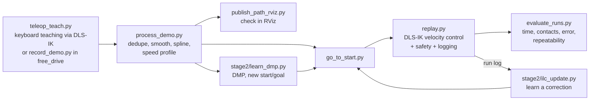

# Task 3 — The Wire-Trace Trial (Addverb HEAL) · Group 8

Goal of the task: guide a ring probe held by the HEAL arm along a vertical, bent "buzz-wire"
**without touching it**, as fast as possible, three times in a row. The robot learns the path from
a demonstration and replays it under joint-velocity control (Stage 1), and optionally gets better
over trials (Stage 2).

**▶ Video (2:25): [https://youtu.be/1M2F7j3zTKM](https://youtu.be/1M2F7j3zTKM)**: the setup, keyboard teaching, the corner where every attempt
failed, and why (lab clips with captions, idle parts sped up).

> ## Status: not completed on the real robot
> - **Software: complete and tested.**
>   - Stage 1 pipeline: teach → record → process → DLS-IK velocity replay → evaluation.
>   - Stage 2: ILC, DMP and stand registration.
>   - Safety layer and tools for the lab.
>   - 18 automated tests pass, and the whole chain runs end to end on a simulated arm.
> - **Real robot: no complete demonstration was recorded, so no replays or final runs exist.**
>   - Every attempt to teach the full path ended in a HEAL safety stop, a collision risk
>     (E-stop) or an unreachable pose, usually at the **corners of the wire**.
> - We found the cause afterwards, by simulating HEAL's real kinematics with our measured setup:
>   - The **wrist geometry of HEAL** makes the ring-roll at the corners need large motions of
>     the whole arm in the layout we used.
>   - We also used a **probe grip** that made this worse.
>   - In addition, there was **no way to record hand-guided motion** (`free_drive` publishes
>     nothing to ROS).
> - A layout that avoids these problems ("side layout", §5) was designed and **verified only in
>   simulation**. We ran out of lab time before we could try it on the robot.
>
> This README documents what was built, what happened in the lab, **why we could not finish**,
> and exactly what is left to do.

---

## Contents
1. [Deliverables at a glance](#1-deliverables-at-a-glance)
2. [What we built](#2-what-we-built)
3. [What happened in the lab](#3-what-happened-in-the-lab)
4. [Why we could not complete the task](#4-why-we-could-not-complete-the-task)
5. [The solution we found (verified in simulation only)](#5-the-solution-we-found-verified-in-simulation-only)
6. [What is left to finish](#6-what-is-left-to-finish)
7. [Setup and launching HEAL](#7-setup-and-launching-heal)
8. [How to run the pipeline](#8-how-to-run-the-pipeline)
9. [Methods](#9-methods)
10. [Safety checklist and E-stop procedure](#10-safety-checklist-and-e-stop-procedure)
11. [Repository layout](#11-repository-layout)
12. [Lessons learned](#12-lessons-learned)

---

## 1. Deliverables at a glance

| Brief item | Status | Where |
|---|---|---|
| Setup: OS, versions, dependencies | ✅ Done | §7 |
| Launch commands (gravity comp / replay) | ✅ Done, starter README commands only | §7 |
| Teaching: record the path | ⚠️ **Code done, no complete demo recorded on HEAL** | §3, §4, `scripts/teleop_teach.py`, `scripts/record_demo.py` |
| Processing: smoothing, interpolation, speed profile | ✅ Done and tested (on synthetic and simulated demos) | §9.1, `scripts/process_demo.py` |
| Replay with DLS-IK joint-velocity control | ✅ Code done, tested in simulation and dry runs; ❌ **not run along the wire** | §9.2, `scripts/replay.py` |
| Speed optimisation | ✅ Speed profile and stepwise procedure; ❌ no real measurements | §9.1, §8 |
| 3 repeatable runs and evaluation | ❌ **Not done** (needs a demo first); evaluation script ready | `scripts/evaluate_runs.py` |
| Safety checklist and E-stop procedure | ✅ Done, and used for real (E-stop pressed several times) | §10 |
| Stage 2 learning (bonus) | ✅ Code done; ILC tested in simulation; ❌ not on the robot | §9.4 |
| Video (≤ 3 min) | ✅ Done (2:25): shows the setup, teaching and the failure at the corner, not a successful run | [https://youtu.be/1M2F7j3zTKM](https://youtu.be/1M2F7j3zTKM) |
| Explanation of the failure and a way forward | ✅ This README, `docs/ROOT_CAUSE_ANALYSIS.md` | §3–§6 |

---

## 2. What we built



**Core pipeline (`wire_trace/`)**
- `trajectory.py` processes the demo:
  - arc-length resampling and Gaussian smoothing with a deviation check
  - cubic spline and orientation smoothing
  - a speed profile limited by velocity, acceleration, lateral acceleration, roll speed and roll acceleration
- `controller.py`:
  - damped-least-squares IK tracker with adaptive damping, feed-forward plus feedback
  - per-joint velocity and acceleration limits
  - reference time-scaling, so the reference waits for the robot instead of the robot cutting corners
  - contour-error, lag and orientation safety
  - stall detector
- `learning.py` (Stage 2): ILC, DMP and Kabsch registration.

**Robot interface**
- `ros_common.py`:
  - reads `/joint_states` and `/robot_description`
  - publishes on `/velocity_controller/commands`, with hard per-joint caps
  - detects stale data and the "all joints exactly 0" readings HEAL reports after an error
  - logs every command
- Kinematics come from the robot's own URDF:
  - `kdl_kinematics.py` (KDL, as in the starter code)
  - `urdf_chain.py`: a numpy copy of the chain (`config/heal_chain.json`), so analysis runs without ROS

**Tools written because of what we ran into in the lab** (§3):

| Tool | Why it exists |
|---|---|
| `scripts/teleop_teach.py` | `free_drive` gives no joint data, so we taught with the keyboard: small exact Cartesian steps, ring roll keys, `--auto-roll`, refusal near singularities and joint limits, BLOCKED detection, go-home |
| `scripts/move_joints.py` | Safe joint moves to a start pose: approach from above, path-clearance check, "robot not following" stop |
| `scripts/find_pose.py`, `scripts/dump_chain.py` | Search where to put the wire stand and how to grip the probe so the whole wire is reachable with HEAL's real kinematics |
| `scripts/check_setup.py` | Topics, URDF, frames, joint limits and the live tool pose in one command |
| `scripts/gripper.py` | Open and close the Robotiq gripper (wraps the starter `GripperController`) |
| `tools/fake_robot.py`, `scripts/simulate_replay.py` | Rehearse every script without the robot |
| `tools/analysis/sim_side_layout.py`, `sim_front_layout.py` | Layout feasibility studies on HEAL's kinematics (§5) |
| `tools/make_lab_guide_pdf.py` | Printable lab guide: `docs/HEAL_Wire_Trace_Lab_Guide.pdf` |

---

## 3. What happened in the lab

**Our setup.**
- **Wire:** about 30 cm × 15 cm, with 4 up-and-down U loops in one vertical plane, 3–4 mm thick.
- **Probe:** a closed ring (inner diameter about 3 cm) on a handle, **threaded on the wire**, so it
  can't be lifted off.
- **Stand:** a 12 cm box with an 8 cm board on top, so the wire centre is about 22 cm above HEAL's base.
- **Gripper:** HEAL with a Robotiq 2-finger gripper holding the handle; the ring sits about 8 cm
  beyond the fingertips.
- **Software constraint:** HEAL may only be launched with the starter README commands.

The table lists every significant event in order, with the message we got. The ✋ rows are E-stops
pressed by our buddy.

| # | What we were doing | What happened (actual message) | Cause (found from logs and later analysis) |
|---|---|---|---|
| 1 | Running our tests on the lab PC | `pytest` crashed loading a ROS plugin | ROS `launch_testing` plugin incompatible with the installed pytest. Fixed with `run_tests.sh` (`PYTEST_DISABLE_PLUGIN_AUTOLOAD=1`) |
| 2 | First start-up | ✋ `Estop pressed` → `failed to run the robot` | E-stop touched by accident. Recovery means a full restart of T1 and T2 |
| 3 | Testing `free_drive` for hand teaching | `check_setup.py --watch` timed out; the T2 launch failed | **`./free_drive` publishes nothing to ROS** (no `/joint_states`), and the velocity launch only works with `./heal_server`. Hand-guided recording (the intended teaching method) was impossible with the allowed commands |
| 4 | Keyboard jog test, **no probe**, roll key `n` for 4–5 taps | `Safety error : Large Velocity for Joint = 1at6`, then `Robot gone into error. Call ErrorRecoveryService` | A wrist roll that HEAL's wrist can barely make (§4.1) was commanded at up to 0.4 rad/s. We added hard caps (0.25 rad/s, wrist 0.10–0.15) |
| 5 | Restart after the error | `Failed to power on robot` | The robot needs a power cycle, which only the TA can do. Lost lab time waiting |
| 6 | `move_joints.py` to a start pose | `STOP: robot not following (joint error 8.6 deg)`; `now (deg): [0 0 0 0 0 0]` | **After an error, HEAL reports every joint as exactly 0** although the arm isn't at zero. Our scripts now refuse to move on all-zero readings |
| 7 | `find_pose.py`: where to put the stand | `no feasible pose` for the layout we had (wire facing the robot, probe straight out of the gripper) | HEAL's joint 3 is limited to ±57° and the wrist to ±30° tilt (§4.1). Only a crosswise grip was found feasible |
| 8 | `move_joints.py` to the start pose next to the wire | ✋ arm touched the box; E-stop | The path check knew the table, not the box, and the pose was at the bottom of the wire. We added approach-from-above and a clearance check, and moved the box away during the move |
| 9 | Same, again | ✋ E-stop, collision imminent | Same cause, before the fix |
| 10 | Gripping the probe | The handle stood perpendicular and the gripper couldn't take it | The orientation of the start pose didn't match how the probe stood. Re-gripped using teleop |
| 11 | Teaching **demo_01** (crosswise grip), going round the first corner with `n`/`m` and `[`/`]` | `Safety error : Large Velocity for Joint = 3at9` | **The ring jammed on the wire.** Rotating the handle swung the ring sideways; the joint was commanded but could not move, then slipped. Our command logs show we never commanded more than 0.12 rad/s (§4.3) |
| 12 | Teaching **demo_02**, same corner | `Large Velocity for Joint`, after the joints were frozen at `[2, 5, -17, -41, 9, 4]°` for 5 s while joint 6 was commanded | Identical to 11. We added a **stall detector** that stops within about 0.6 s |
| 13 | Checking the other group's grip (handle straight out, wire in front) in simulation | Almost never feasible on our stand | Only 2 of 25 placements are feasible, at 65 cm, the edge of the workspace (§4.1, §5) |

**Net result:** we never got the ring once round the whole wire. With no demonstration, nothing
could be replayed, sped up, repeated three times or filmed.

**Time cost.** Each HEAL error meant:
1. stop T2, then stop the container in T1;
2. restart it, run `./base_rigid` (home) and `./heal_server`;
3. relaunch T2, and sometimes get the TA to power-cycle the robot;
4. move the arm back to the wire.

Every failure at a corner therefore cost far more time than the attempt itself.

---

## 4. Why we could not complete the task

Full analysis with tables: [`docs/ROOT_CAUSE_ANALYSIS.md`](docs/ROOT_CAUSE_ANALYSIS.md). Summary:

### 4.1 HEAL's wrist can only tilt about 30° off the forearm direction
In HEAL's URDF, **joint 5's axis is 30° from joint 4's** (the forearm), not 90° as on most 6-axis arms.
We sampled 20,000 random configurations: **the gripper axis is always between 60° and 90° from
the forearm.**
- The gripper can never point along the forearm, for example straight ahead with a stretched arm.
- Any reorientation toward or away from the forearm direction saturates quickly and needs about
  twice the joint speed you'd expect.

Also, **joint 3 is limited to ±57°**, so the elbow can't fold far. Together these explain:
- why `find_pose.py` found no feasible placement for the obvious layouts (event 7);
- why the first roll test tripped HEAL's velocity check (event 4).

### 4.2 The ring must roll about 90° at every corner, unavoidably
Seen from the robot, the wire direction turns through **180°** over every U (up → across → down).
The ring has to stay roughly perpendicular to the wire. For **any fixed ring orientation**, at
every second corner the wire would run edge-on through the ring: 88° misalignment in our
simulation. So the ring must roll about 90° at every top and bottom of every U, about an axis
perpendicular to the wire plane. That's 7 corners, each needing a roll while the ring (about 3 cm, on a 3–4 mm
wire) stays clear of the wire.

### 4.3 With our grip, "roll the ring" meant "swing the whole arm"
We held the handle **across** the fingers, because that was the only feasible grip in our layout
(4.1). Rolling the ring about the handle then means rotating the gripper about a line through the
ring, about 30 cm from the wrist:
- the wrist has to travel about ±20 cm sideways while **all six joints** move;
- the intuitive key (`[`/`]`, joint 6) did the wrong rotation: it **swung the handle like a clock
  hand**;
- at 8 cm, 3–4° of joint 6 moves the ring about 5 mm sideways, enough to bring it into contact.

That is exactly events 11 and 12. HEAL reports a joint that is jammed and then slips as
**"Large Velocity for Joint"**. Our own command log proves our commands were small and smooth:
the maximum per joint was `[0.014 0.026 0.031 0.026 0.031 0.12]` rad/s.

### 4.4 No way to record hand-guided teaching
The brief intends teaching in gravity-compensation mode. With the allowed launch commands,
`./free_drive` publishes **no joint data**, so nothing can be recorded while moving the arm by
hand. We had to teach by **keyboard teleoperation**:
- a person had to translate the ring **and** roll it through 7 corners, in small steps, with a
  few mm of clearance;
- any slip ended in contact, which ended in a HEAL error and a full restart (4.5).

### 4.5 Expensive error recovery
After any safety error:
- HEAL's `/joint_states` reports **fake all-zero joints**;
- the controller needs a full restart;
- sometimes the TA has to power-cycle the robot (`Failed to power on robot`).

There is no recovery command among the allowed starter commands (`ErrorRecoveryService` is
mentioned in the error but not documented).

### 4.6 Practical factors
- **One shared robot, limited lab slots.** Our laptop can't run Claude or the GitHub workflow on
  the lab PC, so every fix went through `git push` → `git pull` while the robot stood idle.
- **The setup was improvised:**
  - the box and board heights were fixed;
  - the stand was taped down by hand;
  - the gripper had to hold a handle that wasn't designed for it.
- **E-stops were the right call every time, but each one cost a restart.**
- **Deadline.** The brief's deadline (16 November) passed while we were still diagnosing the
  corner problem.

---

## 5. The solution we found (verified in simulation only)

We simulated the whole task on HEAL's real kinematics (`config/heal_chain.json`, from the
robot's URDF) with our measured dimensions. The fix is a layout where **rolling the ring is a
single joint (joint 6)**:

- **Grip:** handle **straight out of the gripper**, coaxial with joint 6 (the grip the other group
  used in their video). Joint 6 then turns the ring **in place**, with no swinging.
- **Stand:** **beside** the arm, not in front of it. The wire plane is vertical and parallel to
  the arm's reach direction, about **38 cm to the right**:
  - near end of the wire about 30 cm in front of the base;
  - wire centre about 45 cm in front of the base;
  - same height as before (about 22 cm).
- **Gripper:** points sideways (right). That is always perpendicular to the forearm, so the 30°
  wrist limit (4.1) never comes into play.
- Moving along the wire is just **joints 2 and 3** in a vertical plane. Joints 1, 4 and 5 stay
  constant.
- Teaching uses `teleop_teach.py --auto-roll`, so software turns joint 6 to follow the direction
  of motion; the operator only steers with `a`/`d` (along) and `r`/`f` (up/down).

**Simulation results** (whole wire traced, ring within 40° of perpendicular):

| Layout | Feasible | Joint-limit margin | Min singular value | Joints that move |
|---|---|---|---|---|
| Crosswise grip, wire facing the robot (**what we used**) | yes | 39° | 0.061 | **all six**, arm swings at every corner |
| Straight-out grip, wire facing the robot | barely | 4° | 0.044 | — |
| Other group's layout (straight-out grip, wire in front, gripper horizontal) | 2 of 25 placements, at 65 cm | small | — | — |
| **Side layout, stand on the RIGHT** (recommended) | **yes** | **18°** | **0.108** | **joints 2, 3, 6 only** |
| Side layout, stand on the left | yes | 8–25° | 0.087–0.19 | joints 2, 3, 6 only |

We also simulated a full replay of the side layout on HEAL's model (speed caps, stall detector,
30 ms robot lag):
- completed in **112 s** at speed 1.0, with no stall;
- maximum path error **0.62 mm**;
- peak joint speeds: j2 0.18, j3 0.16, j6 0.135 rad/s, all under the caps (0.25 / 0.25 / 0.15).

Reproduce the feasibility study:
```bash
python3 tools/analysis/sim_side_layout.py side
```
```bash
python3 tools/analysis/sim_front_layout.py 0.65
```

**Caveat:** this has not been tried on the robot. The 8 cm ring offset (`robot.tool_xyz`) must be
measured, and the real robot may behave differently near the wire.

---

## 6. What is left to finish

All code is ready. The remaining work is lab work, about 2–3 hours if nothing goes wrong. Step by
step it is in **[`docs/HEAL_Wire_Trace_Lab_Guide.pdf`](docs/HEAL_Wire_Trace_Lab_Guide.pdf)**:

1. Start HEAL (T1 `./heal_server`, T2 velocity launch).
2. `move_joints.py --deg 0.3 32.5 -32.4 -89.5 -0.2 -36.2 --approach 0.10` (box away).
3. Place the stand in the side layout, grip the handle straight out, measure the ring offset,
   and set `tool_xyz`.
4. Teach with `teleop_teach.py --name demo_side --auto-roll`.
5. Run `process_demo.py`, then dry run → reverse at 0.3 → forward at 0.3 → 1.0.
6. Do 3 × `replay.py --tag final` (with `--reverse` back), then `evaluate_runs.py --tag final`.
7. Optional: ILC iterations (Stage 2).
8. Fill in the results table below and record a new video of the successful runs.

### Results

| Trial | Speed | Time [s] | Contacts | Max path err [mm] |
|---|---|---|---|---|
| final 1 | — | not obtained | — | — |
| final 2 | — | not obtained | — | — |
| final 3 | — | not obtained | — | — |

Simulation only: side layout 112 s, 0.62 mm (§5). ILC on the simulated arm: max error 3.7 → 1.2 mm
in 5 trials (§9.4).

Video of our attempts (no successful run): [https://youtu.be/1M2F7j3zTKM](https://youtu.be/1M2F7j3zTKM)

---

## 7. Setup and launching HEAL

**Lab PC:** Ubuntu 22.04, ROS 2 Humble, Python 3.10, workspace `~/Debojit_WS/addverb_ws`
(the same one the starter code uses). **Robot PC:** HEAL software in a container
(`cobot_safety3_gripperfix_20260908`).

- **ROS packages** (already on the lab PC): `rclpy`, `sensor_msgs`, `std_msgs`, `geometry_msgs`,
  `nav_msgs`, `PyKDL`, `kdl_parser_py`, `urdf_parser_py`.
- **Python packages:** `pip3 install -r requirements.txt` (numpy, scipy, matplotlib, pyyaml; reportlab only to rebuild the PDF).
  - Do **not** `pip install pytest` on the lab PC; run tests with `./run_tests.sh`.
- **Get the code:**
  ```bash
  mkdir -p ~/ITR_2026/Grp8/final && cd ~/ITR_2026/Grp8/final && git clone -b claude/sleepy-bohr-jn2txo https://github.com/yashpatil-bit/Project_3_ITR_YPK.git
  ```
  ```bash
  cd ~/ITR_2026/Grp8/final/Project_3_ITR_YPK && ./run_tests.sh
  ```
  The tests should end with `18 passed`.

### Terminals

| Terminal | Where | What runs there |
|---|---|---|
| T1 | `ssh cobot@192.168.1.25` | The HEAL program: `./heal_server`, `./free_drive` or `./base_rigid` |
| T2 | lab PC | `ros2 launch addverb_cobot_control velocity_control.launch.py` (only with `./heal_server`) |
| T3 | lab PC | Our scripts |
| T4 | lab PC | `contact_monitor.py` during replays |

### Launching: only the starter README commands (`starter_code/LAB_COMMANDS.md`)

**T1**, password `cobot`:
```bash
ssh cobot@192.168.1.25
```
```bash
cd /home/cobot/addverb_images/gripper_fix_2026-09-08/
```
```bash
sudo env HOME=/home/cobot ./cobot run
```
Type `1` (container `cobot_safety3_gripperfix_20260908`), then **one** of:
```bash
./heal_server
```
```bash
./base_rigid
```
```bash
./free_drive
```
- `./heal_server`: our scripts command the robot. Wait for "Start writing velocities to control in
  velocity mode".
- `./base_rigid`: moves the arm home.
- `./free_drive`: move the arm by hand. It publishes **no** ROS data (§4.4).

**T2** (only with `./heal_server`):
```bash
cd ~/Debojit_WS/addverb_ws/ && source install/setup.bash
```
```bash
ros2 launch addverb_cobot_control velocity_control.launch.py
```
Wait for `velocity_controller: activate successful`.

**T3 / T4:**
```bash
cd ~/Debojit_WS/addverb_ws/ && source install/setup.bash && cd ~/ITR_2026/Grp8/final/Project_3_ITR_YPK
```
```bash
python3 scripts/check_setup.py
```
`check_setup.py` should end with `RESULT: ready`.

**Switching mode or recovering from an error:**
1. Ctrl-C in T2.
2. Ctrl-C in T1, then `exit` the container.
3. Run `cobot run` again, type `1`, and start the new program.
4. If it's `./heal_server`, relaunch T2.

If T2 prints `Failed to power on robot`, check the E-stop, then ask the TA to power-cycle.

### Configuration (`config/heal_wire_trace.yaml`)
Every parameter is in this one file.
- `robot.tip_link: rq_tool_tip` is the point between the fingertips.
- `robot.tool_xyz: [0, 0, 0.08]`: the ring centre 8 cm straight out of the gripper. **Measure it.**
- `robot.qdot_hard_limit: [0.25, 0.25, 0.25, 0.10, 0.10, 0.15]` rad/s caps every command any script sends.
- Processing and controller limits are documented inline.

---

## 8. How to run the pipeline

Full details: `INSTRUCTIONS.md` and the PDF guide. Each command goes in its own line in T3.

```bash
python3 scripts/gripper.py open
python3 scripts/move_joints.py --deg 0.3 32.5 -32.4 -89.5 -0.2 -36.2 --approach 0.10
python3 scripts/gripper.py close --force 60
python3 scripts/teleop_teach.py --name demo_side --auto-roll      # c = record, a/d along, r/f up/down, q = save
python3 scripts/process_demo.py data/demos/demo_side.npz          # -> data/processed/demo_side_v5.npz
python3 scripts/replay.py data/processed/demo_side_v5.npz --reverse --dry-run
python3 scripts/replay.py data/processed/demo_side_v5.npz --reverse --speed 0.3
python3 scripts/replay.py data/processed/demo_side_v5.npz --speed 0.3     # then 0.5, 1.0
python3 scripts/replay.py data/processed/demo_side_v5.npz --speed 1.0 --tag final
python3 scripts/replay.py data/processed/demo_side_v5.npz --speed 1.0 --reverse --tag back
python3 scripts/evaluate_runs.py --tag final
```
Contact logging (T4): `python3 scripts/contact_monitor.py --mode keyboard`. Press Enter when the
buzzer sounds. An Arduino version is in `hardware/buzz_contact/`.

If `free_drive` ever publishes joint states (ask the TA), `record_demo.py --name demo_01`
records hand-guided teaching at 50 Hz instead of `teleop_teach.py`.

**Without the robot:**
```bash
./run_tests.sh
```
```bash
python3 scripts/simulate_replay.py --vmax 0.15 --ilc 3
```
```bash
python3 tools/fake_robot.py --make-demo
```

---

## 9. Methods

### 9.1 Processing (`wire_trace/trajectory.py`, `scripts/process_demo.py`)
1. Drop near-duplicate samples (pauses while teaching).
2. Resample by arc length (1 mm) and apply Gaussian smoothing (σ = 3 mm), keeping the end points
   fixed. Warn if the smoothed path deviates more than 1.5 mm from the taught one.
3. Fit a cubic spline p(s). Smooth orientation locally in the tangent space (local windows, so a
   180° wrap can't corrupt it), with SLERP between samples.
4. Speed profile v(s) ≤ min(v_max, √(a_lat/κ), ω_max/|dθ/ds|), with forward and backward
   acceleration passes. It slows down automatically in bends and during ring rolls.
5. Exact time law s(t) (constant acceleration per segment), sampled at 100 Hz. Output:
   `data/processed/<name>_v<cm/s>.npz` plus a preview PNG.

### 9.2 Replay control law (`wire_trace/controller.py`, 100 Hz)
```
(p_d, R_d, v_d, ω_d) = trajectory(τ)
v = k·s·v_d + Kp (p_d − p)        ω = k·s·ω_d + Ko log(R_d Rᵀ)
q̇ = Jᵀ (J Jᵀ + λ² I)⁻¹ [v; ω]     λ grows when σ_min < 0.04
q̇ ← per-joint clamp to q̇_max and q̈_max·dt (direction preserving); if a feed-forward joint
     limit binds, the reference time is slowed instead (time scaling)
τ ← τ + k·s·dt
```
- `s` is the user speed (`--speed`).
- `k ∈ [0.2, 1]` slows the reference when the probe drifts or lags, so the robot never cuts a
  corner into the wire.
- Kinematics come from the URDF through KDL plus the probe offset.

### 9.3 Safety built into every script that moves the robot
- **Before starting:**
  - refuse unless the probe is within 5 mm and 6° of the start;
  - ask for confirmation, then count down 3-2-1;
  - `--dry-run` checks the whole trajectory on HEAL's kinematics first.
- **Abort on any of:**
  - contour error > 6 mm;
  - lag > 3 cm;
  - orientation error > 11°;
  - probe leaves the workspace box;
  - joint within 0.05 rad of a limit;
  - stale or fake-zero `/joint_states`;
  - **stall** (joint commanded but not moving for 0.6 s);
  - Ctrl-C.
- **Hard per-joint velocity caps** on every published command.
- On any stop: ramp to zero, then publish zeros 10 times. The velocity controller keeps executing
  the last command it received.
- **Logs:** every run writes `data/runs/<tag>_<time>.npz/.json/.png`; teleop and replay also save
  the commanded velocities.

### 9.4 Stage 2: learning (bonus, `stage2/`, `wire_trace/learning.py`)
- **Iterative Learning Control:** after each trial, c_{k+1} = Q(c_k + L·e_k(t + lead)), with
  L = 0.7, a 5-sample lead and a Gaussian Q-filter.
  - The correction is limited to |c| ≤ 8 mm.
  - Only the covered part of the path is updated.
  - Safety still checks the true path.
  - **Simulated:** max error 3.7 → 1.2 mm, time 4.7 → 4.05 s over 5 trials.
- **DMP learning from demonstration:** 200 basis functions fitted to several demos. It can be
  regenerated for a new start and goal.
- **Stand registration:** 3+ reference points before and after moving the stand, then a Kabsch
  fit transforms the learned path.

---

## 10. Safety checklist and E-stop procedure

Before every session:
- [ ] Two people: the **operator** at the keyboard and the **buddy** with a hand on the E-stop at
      all times.
- [ ] Stand taped down, nobody in the robot's reach, the robot in clear view.
- [ ] `check_setup.py` → `RESULT: ready` (no fake-zero joints).
- [ ] Large joint moves (`move_joints.py`): **probe off the wire and the box out of the way**,
      approach from above.
- [ ] New trajectory: `--dry-run` first, then speed 0.3, then raise it.
- [ ] Never move the jog keys *into* the wire plane (`w`/`s` in the side layout) while the ring is
      on the wire.

E-stop procedure (used several times; see §3):
1. Anything unexpected (wrong direction, contact, odd noise, imminent collision) → the buddy
   presses the E-stop **immediately**.
2. Ctrl-C in every terminal that publishes commands.
3. Free the probe from the wire by hand, open the gripper and inspect the wire.
4. Restart T1 and T2 (§7). If `Failed to power on robot` appears, call the TA.
5. Find the cause in `data/runs/` before trying again.

---

## 11. Repository layout

| Path | What it is |
|---|---|
| `README.md` | This file: status, failure analysis, how to run |
| `docs/HEAL_Wire_Trace_Lab_Guide.pdf` | **Printable step-by-step lab guide** (terminals, every command) |
| `docs/ROOT_CAUSE_ANALYSIS.md` | Detailed analysis of the failures and the side layout |
| `docs/LAB_STATUS.md`, `docs/TODAY_IN_LAB.md`, `docs/LAB_PLAYBOOK.md` | Lab notes from the sessions (historical; superseded by the PDF) |
| `INSTRUCTIONS.md` | Long-form guide to every script and option |
| `config/heal_wire_trace.yaml` | All parameters |
| `config/heal_chain.json` | HEAL kinematic chain extracted from the robot's URDF |
| `wire_trace/` | Library: trajectory, controller, learning, kinematics, ROS I/O, logging, plotting |
| `scripts/` | Everything run in the lab (all take `-h`) |
| `stage2/` | `ilc_update.py`, `learn_dmp.py`, `register_stand.py` |
| `tools/` | `fake_robot.py`, `analysis/` (layout simulations), `make_lab_guide_pdf.py` |
| `tests/` | `./run_tests.sh`: 18 tests, including an end-to-end run on the fake robot |
| `hardware/buzz_contact/` | Optional Arduino contact sensor for the buzz-wire |
| `starter_code/` | Course starter code (one bug fix: a missing topic argument) |
| `data/` | Demos, processed trajectories, run logs (empty: no real runs were completed) |

---

## 12. Lessons learned

1. **Check the robot's kinematics before building the setup.** A 10-minute feasibility check with
   the real URDF would have shown that HEAL's wrist (30° between joints 4 and 5) and joint 3
   (±57°) rule out the "obvious" layouts. We placed the stand first and analysed later.
2. **Make the hardest motion the simplest one for the robot.** The corners need a 90° ring roll
   seven times. The layout should make that roll a single joint (side layout), not a whole-arm
   motion (crosswise grip).
3. **"Large Velocity for Joint" on HEAL can mean contact, not speed.** A joint that is jammed
   (ring on the wire) and then slips trips the velocity check. Logging our own commands proved
   this, and it's why we added the stall detector.
4. **Check the teaching method first.** `free_drive` gave no data, which forced keyboard teaching,
   which is much harder through tight corners. We should have asked the TA how recording in
   gravity-compensation mode is meant to work before the first session.
5. **Errors are expensive on a shared robot.** After an error HEAL reports fake zero joints and
   often needs a power cycle. Conservative caps, dry runs and stall detection matter more than
   speed.
6. **Collisions come from what the software doesn't know about.** The box wasn't in our path
   check; approach from above and keep obstacles away during large moves.

## License
MIT (see `LICENSE`; starter code © RC-DS).
